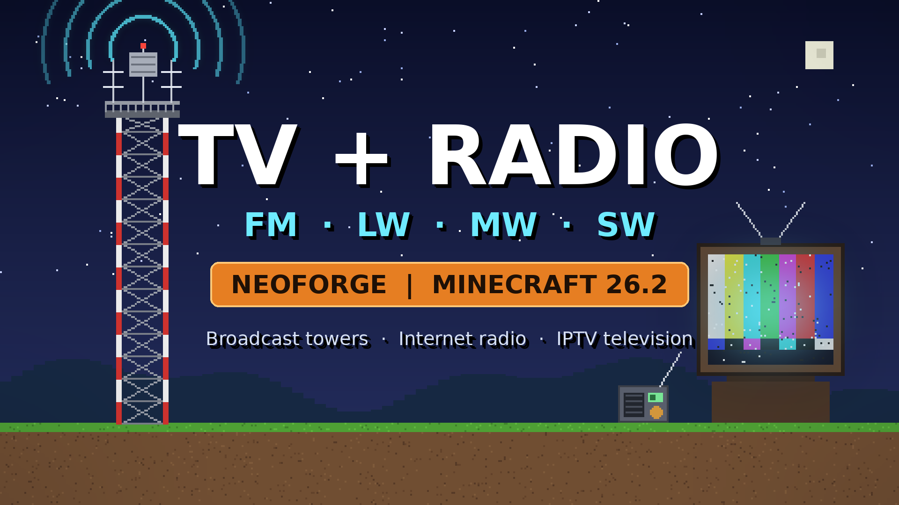
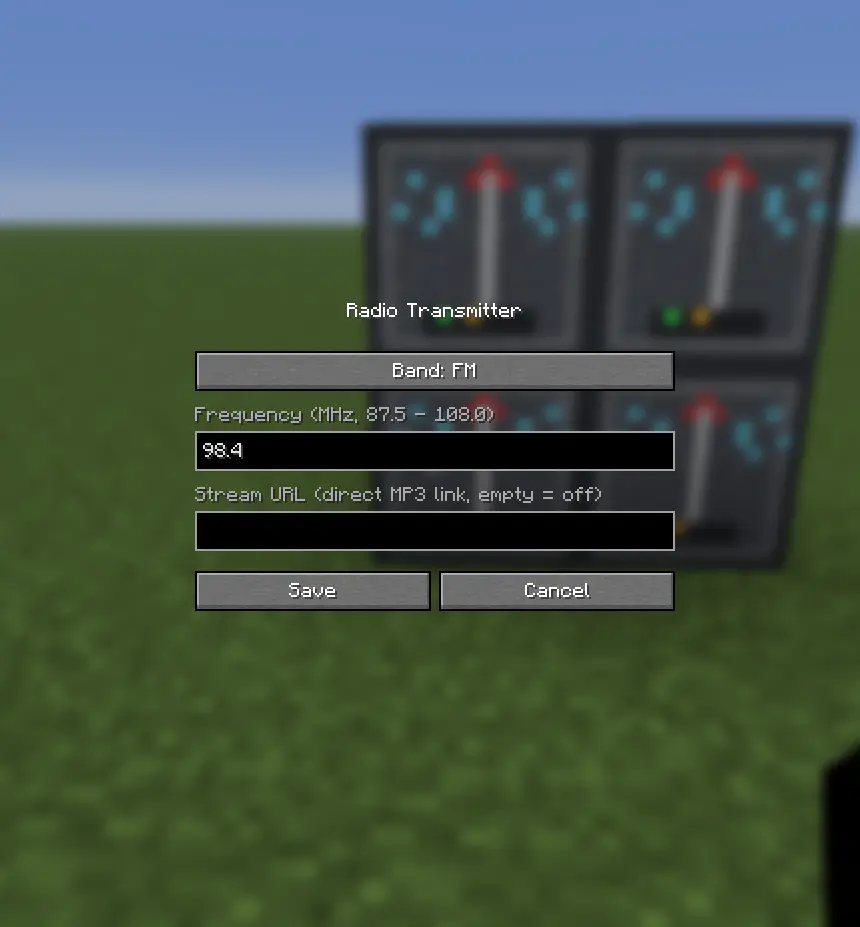
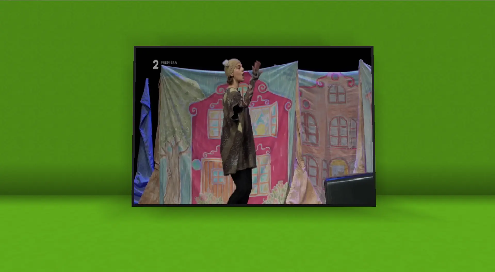
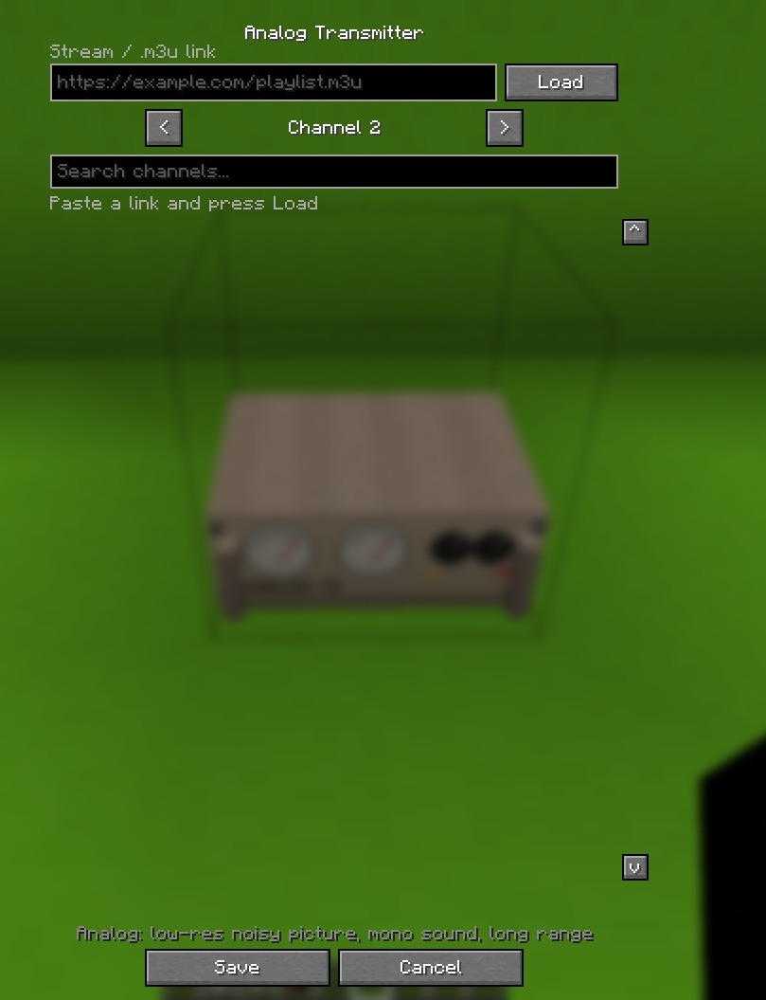
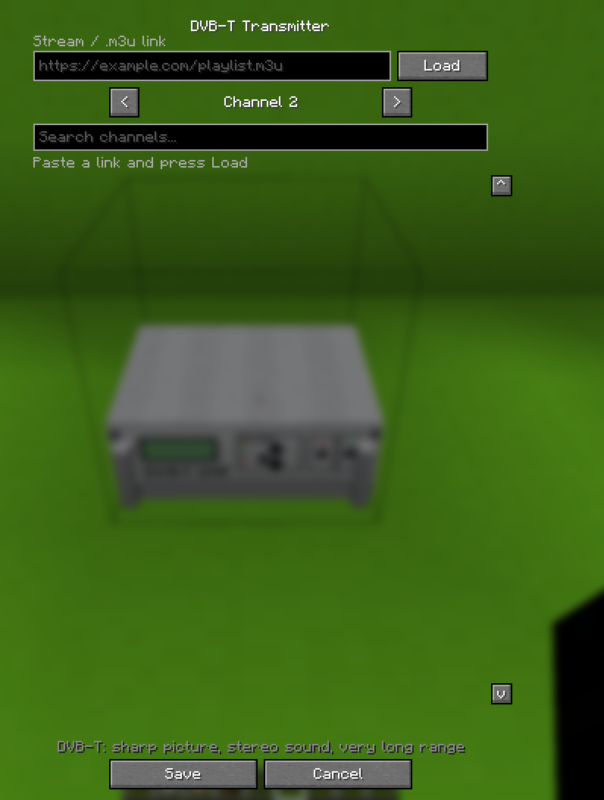
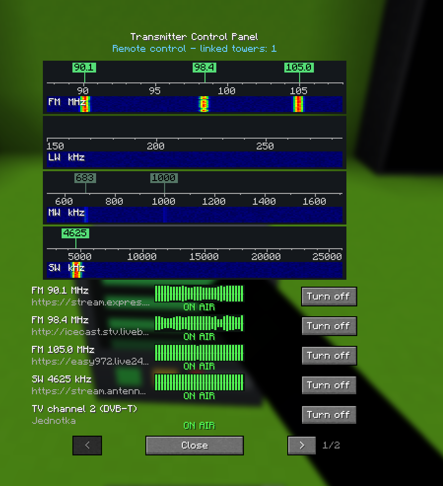

# TV + FM/LW/MW/SW Radio

**NeoForge · Minecraft 26.2 · Java 25**

One mod (ID `tvfmradio`) that combines two parts that work together:

*   📻 **Radio (FM, LW, MW, SW)** – a transmitter plays an internet radio station (MP3 stream) on the frequency you set. Players within range hear it through the **Portable Radio** or the **Radio Receiver** block.
*   📺 **TV** – televisions show live video from IPTV streams (`.m3u` playlists) broadcast from **DVB-T** or **analog** transmitters.

There are two ways to get a signal into the air:

*   **Broadcast Tower** – a realistic 2x2 lattice tower with a service platform on top. **FM** radio and **TV** (DVB-T / analog) transmitters use it. The transmitter can stand anywhere and is joined to the tower with a **Coaxial Cable**.
*   **Transmitter Tower** – the tall single-block lattice mast for **AM** (LW / MW / SW) transmitters. The AM transmitter has to touch it.

Both share the **Transmitter Control Panel**. In the creative menu you will find two tabs: **FM/LW/MW/SW Radio** and **TV Mod**.

***

## Requirements

*   NeoForge for Minecraft 26.2
*   Minecraft 26.2
*   Java 25
*   The mod must be installed on the **server and** on every player's client.

***

## Quick start – your first FM station

1.  Craft **Antenna Rods** (4 pcs) and a **Radio Circuit** (see [Recipes](#recipes)).
2.  Build the tower. Craft some **Broadcast Tower** layers and right-click to place one: **one item places a whole 2x2 layer**. Stack as many layers as you like (taller = more range), then put one **Broadcast Tower Platform** on top.
3.  Craft an **FM Antenna** and place it on one of the three **mounting posts** of the platform (not on the corner with the hatch).
4.  Craft an **FM Transmitter** and place it **anywhere you like** – it does not have to touch the tower.
5.  Craft **Coaxial Cable** and run a cable from the transmitter to the tower. Cables connect to each other, to transmitters and to the tower automatically. Standing next to the tower is **not** enough; the transmitter needs the cable.
6.  Right-click the transmitter: enter the frequency and the link to a **direct MP3 stream**, then Save. Right-clicking it also shows whether it is connected and how tall the tower is.
7.  Craft a **Portable Radio**; it is enough to have it **anywhere in your inventory**. Right-click opens it, tune it to the same frequency. If you are in range it plays and the signal strength is shown as a percentage above the hotbar.

> **AM instead?** Build a **Transmitter Tower** (see [AM tower](#am-tower-lw-mw-sw)), put an **AM Transmitter** so that it **touches a tower block**, pick LW, MW or SW and a frequency, and listen the same way.

***

## Radio

### Bands

| Band | Frequency | Base range | Extra range per tower block |
| --- | --- | --- | --- |
| **FM** | 87.5 – 108.0 MHz | 30 blocks | 200 |
| **LW** (long wave) | 150 – 285 kHz | 90 blocks | 450 |
| **MW** (medium wave) | 530 – 1710 kHz | 60 blocks | 300 |
| **SW** (short wave) | 2300 – 26100 kHz | 150 blocks | 800 |

*   FM stations are made by the **FM Transmitter**, LW / MW / SW stations by the **AM Transmitter** (it has one fixed frequency).
*   The stream URL must start with `http://` or `https://` and must be a **direct MP3 stream**. The mod rejects `.m3u`, `.m3u8` and `.pls` playlists.
*   A receiver hears a station when it is tuned close enough to the frequency: FM within 0.05 MHz, LW 1 kHz, MW 4 kHz, SW 5 kHz.
*   A transmitter remembers its settings even when you turn it off with the Control Panel.
*   The server remembers transmitters even in unloaded chunks, so the signal reaches far beyond render distance. The closer you are, the stronger the signal; at the edge of the range it is weak.

### Range

**FM range = 30 + Broadcast Tower height × 200 blocks**

*   The **height** is the number of blocks from the lowest to the highest block of the tower (every 2x2 layer counts 1, the platform counts as a layer). Antennas do **not** add range, they only put the transmitter on air.
*   Example: 20 layers + the platform = 21 → 30 + 21 × 200 = **4,230 blocks**.

**AM range = band base + (Transmitter Tower blocks + Antenna Dishes) × the band's value from the table.**

*   Example: 10 tower blocks + 2 dishes on MW = 60 + 12 × 300 = **3,660 blocks**.

A maximum of 4,096 connected tower blocks is counted.

### Portable Radio

*   Right-click opens a screen: on/off, band tabs (FM / LW / MW / SW), tuning with the buttons or the mouse wheel over the dial, manual frequency entry, volume.
*   The **Stations in range** list shows up to 3 stations in range; click one to tune in.
*   Settings (on, band, frequency, volume) are saved on the player's side in `config/fmradio.properties`.
*   If the Portable Radio is on, it takes priority over the Radio Receiver block.

### Radio Receiver (desktop radio)

*   A block that plays its tuned station for players **within 16 blocks**. Volume decreases with distance.
*   Right-click opens a settings screen (on/off, band, frequency, volume).

### Radio Jammer

*   Radios near it get a weak, noisy signal and **TVs in range show a completely blurred picture**.
*   Default radius is **48 blocks** (`jammer_range_blocks`). A redstone signal switches it off. Right-click shows its status.

***

## Broadcast Tower (FM and TV)

The Broadcast Tower is built like a real hilltop transmitter: a lattice shaft, a service platform, and the antennas on top. The transmitters stand in a "building" at the foot and are joined to it with a cable.

| Block | What it does |
| --- | --- |
| **Broadcast Tower (2x2 layer)** | One item places a **whole 2x2 layer** (four corner legs with cross bracing). Stack layers upwards. The colour alternates red/white every 3 blocks. It can be climbed. Breaking any block of a layer removes the whole layer (it drops one item). |
| **Broadcast Tower Platform** | The service deck for the top: floor, double railing, and a **hatch** in the corner you placed it so you can climb up through it. The other three corners have a **mounting post** for antennas. It also counts as a tower layer. |
| **FM Antenna** | Crossed dipoles. Place it on a mounting post of the platform, or on top of another antenna (they stack into a mast). An **FM Transmitter** needs at least one. |
| **TV Antenna** | Two panel arrays, rotates to face you. Same placement rules. **DVB-T and Analog Transmitters** need at least one. |
| **Coaxial Cable** | Joins a transmitter to the tower. Plugs into transmitters, the tower and other cables. The arms you see are exactly the connections that count (max 1024 cable blocks per chain). |
| **Tower Warning Light** | The red light can also stand on the platform or on an antenna. |

How it works:

*   A transmitter broadcasts only when a **cable chain joins it to a Broadcast Tower** that has the **matching antenna** on its platform (FM Antenna for FM, TV Antenna for DVB-T / analog).
*   Several transmitters can share one cable and one tower (for example an FM station and a DVB-T channel).
*   If a cable reaches more than one tower, the best one is used: one that has the right antenna, then the tallest.
*   The Broadcast Tower needs **no guy wires** and never collapses.
*   Right-click a transmitter to see whether it is connected, whether the tower has the right antenna, and how tall it is.

***

## AM tower (LW / MW / SW)

The **AM Transmitter** has to **touch a Transmitter Tower block** (any side). It does not use cables or the Broadcast Tower.

| Block | What it does |
| --- | --- |
| **Transmitter Tower** | The basic segment. It can be climbed, is hollow between its four legs, and alternates red/white every 3 blocks of height. |
| **Tower Top** | A pyramid-shaped top that still counts as a tower block. Place it on top. |
| **Tower Warning Light** | A red warning light that must stand on a tower block. It blinks for 1 second and then stays lit. |
| **Tower Platform** | A platform with a railing. It can only be placed next to the tower or another platform, so it chains outward. |
| **Antenna Dish** | Click the side (or top/bottom) of a tower block. It adds range, like one more tower block. |
| **Tower Stability** | A tower taller than **48 blocks** needs at least one guy wire tied to it, otherwise it is unstable. Players within 96 blocks get a warning and the tower creaks and smokes for **30 seconds**. Tie a guy wire to it within that time and it stays standing. If you don't, the tower buckles in its lower third and the part above falls. Removing the wires or breaking the anchor makes a tall tower unstable again. One wire anywhere on the tower is enough. |

**Guy wires:** right-click with the wire on the anchor, then on the tower (or the other way round). The point on the tower must be higher than the anchor and at most 64 blocks from it; one anchor holds 4 wires. Sneak + right-click with an empty hand on the anchor removes all wires. They have no effect on range.

***

## Television

### Step by step

1.  Build a **Broadcast Tower** with a **Platform** on top (see above).
2.  Place a **TV Antenna** on a mounting post of the platform. Without it the TV transmitter will not broadcast.
3.  Craft a **DVB-T Transmitter** or **Analog Transmitter**, place it anywhere, and join it to the tower with **Coaxial Cable**. Right-clicking it shows in an overlay message whether it is connected and the tower height.
4.  On the transmitter's screen:
    *   use the `<` `>` arrows to choose a **channel number 2 – 36**,
    *   enter the link to an `.m3u` playlist (for example from the iptv-org collection) and press **Load**,
    *   in the channel list you can search; click a channel and press **Save**.
5.  Place a **Vintage TV** or **Modern TV**. Right-click opens the channel list. Each entry shows the channel number, the real name, whether you are in range, and the distance. There is also a volume slider and a Turn off button.
6.  The TV must be tuned to the **same channel number** as the transmitter. If nothing is broadcasting, it shows `NO SIGNAL`.

### DVB-T vs. analog

|                 | DVB-T                 | Analog                        |
| --------------- | --------------------- | ----------------------------- |
| Base range      | 1,500 blocks          | 2,200 blocks                  |
| Picture         | sharp, smooth, 20 fps | low resolution, noise, 10 fps |
| Sound           | stereo                | mono, "telephone" sound       |

**TV range = base range + Broadcast Tower height × 50 blocks** (`towerRangePerBlock`). Example: DVB-T on a 21-block tower = 1,500 + 21 × 50 = **2,550 blocks**.

### Televisions

*   **Vintage TV** is always 1×1.
*   **Modern TV** joins with neighbours (same direction, same wall) into one large screen of up to **6 × 4**. Channel and volume change for the whole screen at once.
*   Sound is played by the nearest tuned TV within **20 blocks**.

### Rabbit Ears Antenna

Place it on top of a TV (click the top side). The TV then receives every channel within at least 128 blocks. With the default values this changes nothing; it only helps if you reduce the transmitters' range in the config.

### TV Remote

Right-click switches the nearest TV within 16 blocks to the next channel, **sneak + right-click** to the previous one. Order: off → 2 → … → 36 → off.

***

## Control Panel and Remote Link

The **Transmitter Control Panel** is a console that lists all radio frequencies and TV channels on the tower it touches, including FM and TV transmitters joined to that tower by cable. For each one it shows the status (**ON AIR / NO SIGNAL / OFF**) and lets you switch it on or off.

**Remote control (Remote Link):**

1.  Right-click a tower block with the Remote Link to select the tower you want to control.
2.  Right-click the panel with the Remote Link.
3.  The panel now controls that tower from any distance. One panel handles up to **8 towers**.
4.  Sneak + right-click on the panel removes its links.

***

## Configuration

**`config/tvmod.json`** (client and server)

| Key | Default | Meaning |
| --- | --- | --- |
| `ffmpegPath` | `ffmpeg` | path to ffmpeg |
| `autoDownloadFfmpeg` | `true` | automatic download (Windows/macOS) |
| `antennaRange` | `128` | minimum range with Rabbit Ears |
| `dvbtRange` | `1500` | DVB-T base range (0 = unlimited) |
| `analogRange` | `2200` | analog base range (0 = unlimited) |
| `towerRangePerBlock` | `50` | blocks of TV range added per block of Broadcast Tower height |
| `dvbtFps` / `analogFps` | `20` / `10` | picture smoothness |
| `requireTower` | `true` | the TV transmitter must be cabled to a Broadcast Tower with a TV Antenna |
| `audioRadius` | `20` | TV sound radius |

**`config/fmradio.properties`** (client only) contains the volume, the base ranges `range_fm_blocks`, `range_lw_blocks`, `range_mw_blocks`, `range_sw_blocks`, the per-tower-block ranges `tower_range_fm_blocks` (and `_lw_`, `_mw_`, `_sw_`), `jammer_range_blocks` (48), and the saved Portable Radio settings.

***

## Recipes

### Radio parts and devices

| Item | Gives | Crafting (`_` = empty slot) |
| --- | --- | --- |
| **Antenna Rod** | 4 | `I / C / I` (`C` = Copper Ingot, `I` = Iron Ingot) |
| **Radio Circuit** | 1 | shapeless: Redstone, Copper Ingot, Gold Nugget, Gold Nugget |
| **FM Transmitter** | 1 | `_A_ / ICI / IGI` (`A` = Antenna Rod, `C` = Radio Circuit, `G` = Gold Ingot, `I` = Iron Ingot) |
| **AM Transmitter** | 1 | `_A_ / ICI / III` (`A` = Antenna Rod, `C` = Radio Circuit, `I` = Iron Ingot) |
| **Portable Radio** | 1 | `_A_ / ICI / INI` (`A` = Antenna Rod, `C` = Radio Circuit, `I` = Iron Ingot, `N` = Note Block) |
| **Radio Receiver** | 1 | `PPP / NCN / PPP` (`C` = Radio Circuit, `N` = Note Block, `P` = Planks (any)) |
| **Radio Jammer** | 1 | `ARA / CBC / III` (`A` = Antenna Rod, `B` = Redstone Block, `C` = Radio Circuit, `I` = Iron Ingot, `R` = Redstone) |
| **Transmitter Control Panel** | 1 | `III / GCG / III` (`C` = Radio Circuit, `G` = Glass Pane, `I` = Iron Ingot) |
| **Remote Link** | 1 | `A / C / I` (`A` = Antenna Rod, `C` = Radio Circuit, `I` = Iron Ingot) |

### Broadcast Tower

| Item | Gives | Crafting (`_` = empty slot) |
| --- | --- | --- |
| **Broadcast Tower (2x2 layer)** | 2 | `IBI / B_B / IBI` (`B` = Iron Bars, `I` = Iron Ingot) |
| **Broadcast Tower Platform** | 1 | `III / BBB / I_I` (`B` = Iron Bars, `I` = Iron Ingot) |
| **FM Antenna** | 1 | `R_R / RIR / _I_` (`I` = Iron Ingot, `R` = Antenna Rod) |
| **TV Antenna** | 1 | `RRR / RIR / _I_` (`I` = Iron Ingot, `R` = Antenna Rod) |
| **Coaxial Cable** | 8 | `DDD / CCC / DDD` (`C` = Copper Ingot, `D` = Black Dye) |

### AM tower

| Item | Gives | Crafting (`_` = empty slot) |
| --- | --- | --- |
| **Transmitter Tower** | 4 | `RBR / _B_ / RBR` (`B` = Iron Bars, `R` = Antenna Rod) |
| **Tower Top (Pyramid)** | 1 | `R / T` (`R` = Antenna Rod, `T` = Transmitter Tower) |
| **Tower Warning Light** | 1 | `G / R / I` (`G` = Red Stained Glass, `I` = Iron Ingot, `R` = Redstone) |
| **Tower Platform** | 4 | `BBB / I_I` (`B` = Iron Bars, `I` = Iron Ingot) |
| **Antenna Dish** | 1 | `A / A / A` (`A` = Antenna Rod) |
| **Guy Wire** | 6 | `I / S / I` (`I` = Iron Ingot, `S` = String) |
| **Guy Anchor** | 2 | `CIC / CCC` (`C` = Cobblestone, `I` = Iron Ingot) |

### TV

| Item | Gives | Crafting (`_` = empty slot) |
| --- | --- | --- |
| **DVB-T Transmitter** | 1 | `_L_ / IRI / III` (`I` = Iron Ingot, `L` = Antenna Rod, `R` = Redstone Block) |
| **Analog Transmitter** | 1 | `_L_ / IRI / III` (`I` = Iron Ingot, `L` = Antenna Rod, `R` = Redstone) |
| **Vintage Television** | 1 | `PPP / PGP / PRP` (`G` = Glass Pane, `P` = Planks (any), `R` = Redstone) |
| **Modern Television** | 1 | `III / IGI / IRI` (`G` = Glass Pane, `I` = Iron Ingot, `R` = Redstone) |
| **Rabbit Ears Antenna** | 1 | `I_I / _C_ / III` (`C` = Copper Ingot, `I` = Iron Ingot) |
| **TV Remote** | 1 | `_R_ / IBI / _I_` (`B` = Stone Button, `I` = Iron Ingot, `R` = Redstone) |

***

## Troubleshooting

| Problem | Cause / solution |
| --- | --- |
| The FM radio does not play and reports "no signal" | The FM Transmitter is not joined to a Broadcast Tower with a **Coaxial Cable**, the tower has no **FM Antenna** on its platform, the frequency does not match, or you are out of range. Right-click the transmitter for the exact reason. |
| The cable does not connect | Cable blocks must touch face to face. The cable has to touch the transmitter at one end and a block of the Broadcast Tower (not an antenna) at the other. |
| The AM radio does not play | The AM Transmitter must **touch** a Transmitter Tower block; cables and the Broadcast Tower are not used for AM. |
| The transmitter will not save the URL | The radio requires a direct MP3 stream (http/https), not `.m3u` or `.pls`. |
| The TV shows `NO SIGNAL` | Nobody is broadcasting on that channel, the TV is tuned to a different number, or the transmitter is off or out of range. |
| The TV transmitter does not broadcast | It is not joined to a Broadcast Tower by cable, or the tower has no **TV Antenna** on its platform (or turn off `requireTower`). |
| I cannot place a tower layer or platform | A 2x2 area is needed, and all four spaces must be free. |
| I cannot place an antenna | Antennas stand on a platform mounting post or on another antenna; the hatch corner has no post. |
| The TV shows no picture and reports an ffmpeg error | Install ffmpeg (Linux) or set `ffmpegPath`. On Windows/macOS check your network during the first download. |
| The panel says it has no tower | Place it so it touches a tower, or link it using the Remote Link. |
| The (AM) tower collapsed | It was taller than 48 blocks and had no guy wire tied to it. Tie a guy wire to the tower when you see the warning. The Broadcast Tower never collapses. |

***

## Notes

*   The list of radio transmitters is saved in the file `fmradio_stations.tsv` in the world, so it survives a server restart.
*   Each part of the mod has its own item IDs (`fmradio:` and `tvmod:`); for example `fmradio:fm_transmitter` is the FM transmitter, `fmradio:transmitter` is the AM transmitter and `tvmod:transmitter` is the DVB-T transmitter.
*   The old FM/TV Mast, the TV Tower Antenna and the earlier concrete tower test blocks were removed in favour of the Broadcast Tower.
*   Specific in-game texts may differ slightly from this description. **Author:** firi_tajiii8095
