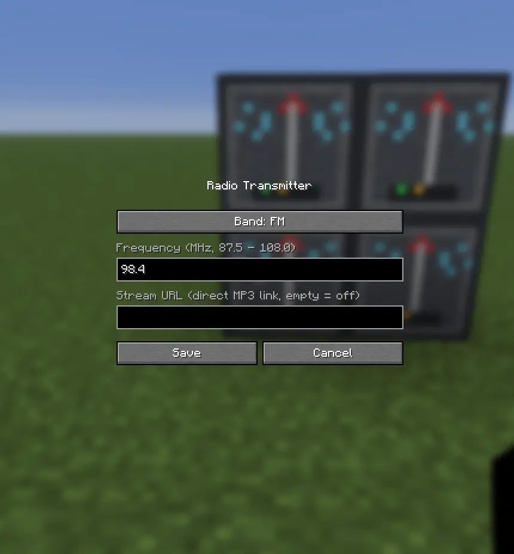
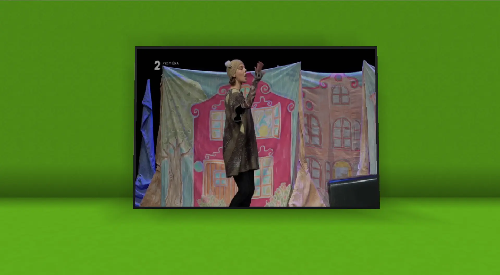
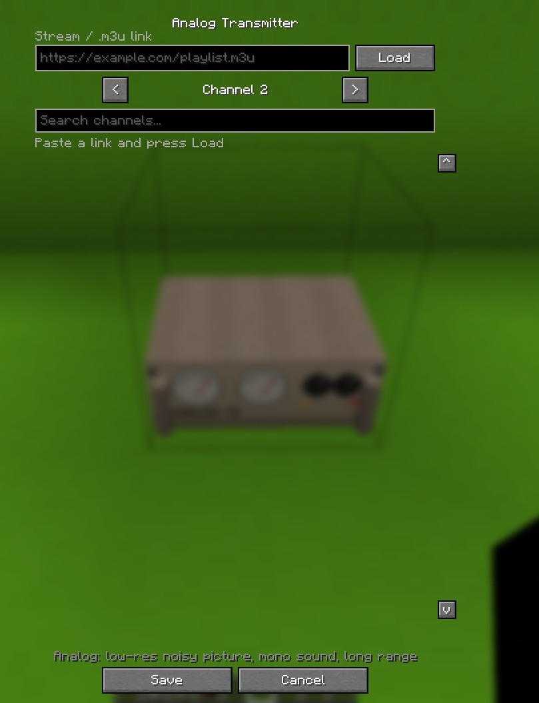
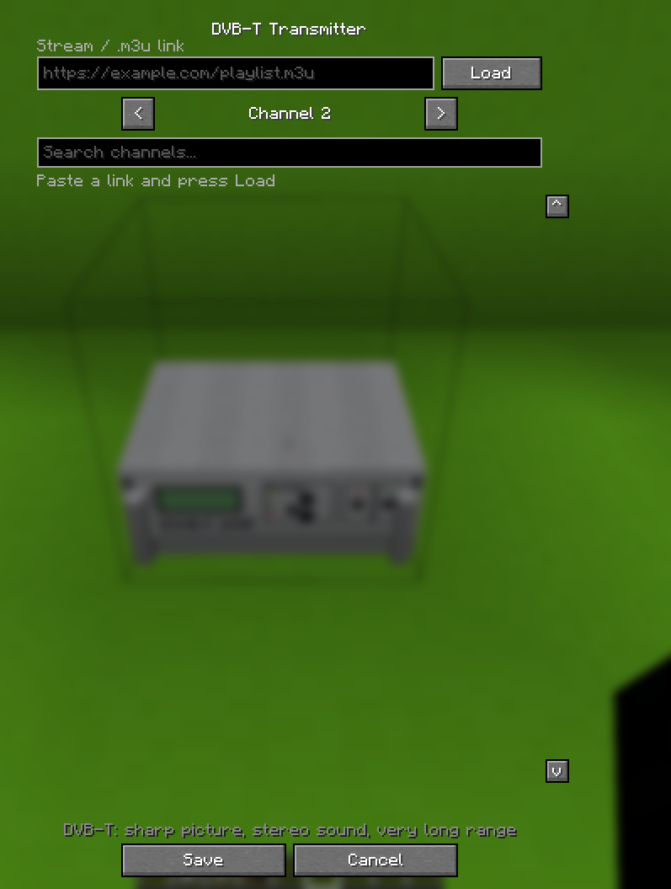
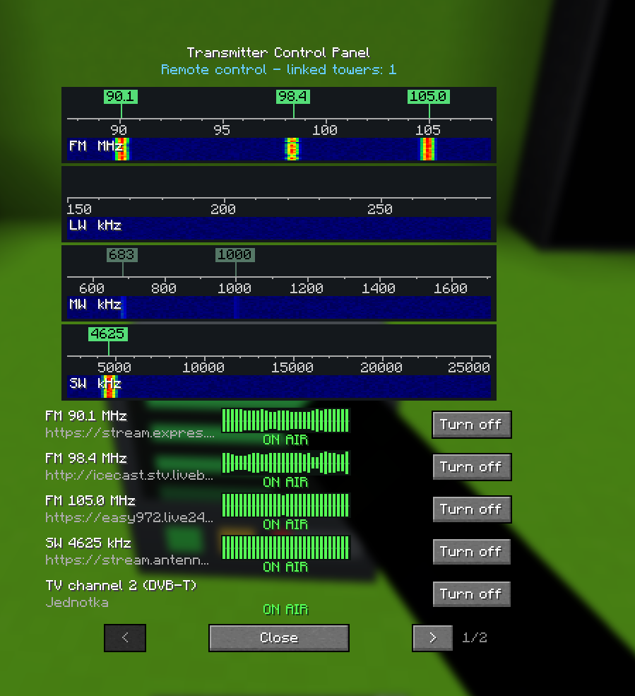

# TV + FM/LW/MW/SW Radio

**Fabric · NeoForge · Minecraft 26.2 · Java 25**

Jeden mod (ID `tvfmradio`), ktorý spája dve časti, čo spolu fungujú:

*   📻 **Rádio (FM, LW, MW, SW)** – vysielač prehráva internetovú rozhlasovú stanicu (MP3 stream) na frekvencii, ktorú nastavíš. Hráči v dosahu ju počujú cez **Portable Radio** alebo blok **Radio Receiver**.
*   📺 **TV** – televízory zobrazujú živé video z IPTV streamov (`.m3u` zoznamy) vysielané z **DVB-T** alebo **analógových** vysielačov.

Signál sa dá dostať do éteru dvoma spôsobmi:

*   **Broadcast Tower** – realistická mriežková veža 2x2 s obslužnou plošinou navrchu. Používajú ju **FM** rádio a **TV** (DVB-T / analóg) vysielače. Vysielač môže stáť kdekoľvek a s vežou sa spája **Coaxial Cable** (koaxiálnym káblom).
*   **Transmitter Tower** – vysoký jednoblokový mriežkový stožiar pre **AM** (LW / MW / SW) vysielače. AM vysielač sa jej musí dotýkať.

Obe využívajú spoločný **Transmitter Control Panel**. V kreatívnom menu nájdeš dve záložky: **FM/LW/MW/SW Radio** a **TV Mod**.

***

## Požiadavky

*   Minecraft 26.2 a Java 25
*   **Verzia pre Fabric:** Fabric Loader 0.19.5+ a Fabric API
*   **Verzia pre NeoForge:** NeoForge pre Minecraft 26.2
*   Súbor pre svoj loader (Fabric alebo NeoForge) vyber vo výbere sťahovania na stránke modu.
*   Mod musí byť nainštalovaný na **serveri aj** u každého hráča na klientovi.

***

## Rýchly štart – tvoja prvá FM stanica

1.  Vyrob **Antenna Rods** (4 ks) a **Radio Circuit** (pozri [Recepty](#recepty)).
2.  Postav vežu. Vyrob niekoľko vrstiev **Broadcast Tower** a pravým klikom ju polož: **jeden predmet položí celú vrstvu 2x2**. Poskladaj koľko vrstiev chceš (vyššia = väčší dosah) a navrch daj jednu **Broadcast Tower Platform**.
3.  Vyrob **FM Antenna** a polož ju na jeden z troch **montážnych stĺpikov** plošiny (nie na roh s poklopom).
4.  Vyrob **FM Transmitter** a polož ho **kamkoľvek** – nemusí sa dotýkať veže.
5.  Vyrob **Coaxial Cable** a veď kábel od vysielača k veži. Káble sa medzi sebou, s vysielačmi aj s vežou spájajú automaticky. Stáť vedľa veže **nestačí**, vysielač potrebuje kábel.
6.  Pravým klikom na vysielač zadaj frekvenciu a odkaz na **priamy MP3 stream**, potom Save. Pravý klik zároveň ukáže, či je vysielač pripojený a aká vysoká je veža.
7.  Vyrob **Portable Radio**; stačí ho mať **kdekoľvek v inventári**. Pravý klik ho otvorí, naladíš ho na rovnakú frekvenciu. Ak si v dosahu, hrá a sila signálu sa zobrazuje v percentách nad hotbarom.

> **Radšej AM?** Postav **Transmitter Tower** (pozri [AM veža](#am-veža-lw--mw--sw)), polož **AM Transmitter** tak, aby sa **dotýkal bloku veže**, vyber LW, MW alebo SW a frekvenciu a počúvaj rovnako.

***

## Rádio

### Pásma

| Pásmo | Frekvencia | Základný dosah | Extra dosah na blok veže |
| --- | --- | --- | --- |
| **FM** | 87,5 – 108,0 MHz | 30 blokov | 200 |
| **LW** (dlhé vlny) | 150 – 285 kHz | 90 blokov | 450 |
| **MW** (stredné vlny) | 530 – 1710 kHz | 60 blokov | 300 |
| **SW** (krátke vlny) | 2300 – 26100 kHz | 150 blokov | 800 |

*   FM stanice vytvára **FM Transmitter**, LW / MW / SW stanice **AM Transmitter** (má jednu pevnú frekvenciu).
*   URL streamu musí začínať `http://` alebo `https://` a musí to byť **priamy MP3 stream**. Mod odmieta zoznamy `.m3u`, `.m3u8` a `.pls`.
*   Prijímač stanicu počuje, ak je naladený dostatočne blízko frekvencie: FM do 0,05 MHz, LW 1 kHz, MW 4 kHz, SW 5 kHz.
*   Vysielač si pamätá svoje nastavenia, aj keď ho vypneš cez Control Panel.
*   Server si pamätá vysielače aj v nenačítaných chunkoch, takže signál siaha ďaleko za dohľad vykresľovania. Čím si bližšie, tým je signál silnejší; na okraji dosahu je slabý.

### Dosah

**Dosah FM = 30 + výška Broadcast Tower × 200 blokov**

*   **Výška** je počet blokov od najnižšieho po najvyšší blok veže (každá vrstva 2x2 sa rátá ako 1, plošina sa rátá ako vrstva). Antény dosah **nezvyšujú**, len uvedú vysielač do vysielania.
*   Príklad: 20 vrstiev + plošina = 21 → 30 + 21 × 200 = **4 230 blokov**.

**Dosah AM = základ pásma + (bloky Transmitter Tower + Antenna Dishes) × hodnota pásma z tabuľky.**

*   Príklad: 10 blokov veže + 2 taniere na MW = 60 + 12 × 300 = **3 660 blokov**.

Počíta sa najviac 4 096 prepojených blokov veže.

### Portable Radio

*   Pravý klik otvorí obrazovku: zapnutie/vypnutie, záložky pásiem (FM / LW / MW / SW), ladenie tlačidlami alebo kolieskom myši nad stupnicou, ručné zadanie frekvencie, hlasitosť.
*   Zoznam **Stations in range** ukáže až 3 stanice v dosahu; kliknutím sa naladíš.
*   Nastavenia (zapnuté, pásmo, frekvencia, hlasitosť) sa ukladajú na strane hráča do `config/fmradio.properties`.
*   Ak je Portable Radio zapnuté, má prednosť pred blokom Radio Receiver.

### Radio Receiver (stolové rádio)

*   Blok, ktorý prehráva naladenú stanicu hráčom **do 16 blokov**. Hlasitosť klesá so vzdialenosťou.
*   Pravý klik otvorí obrazovku nastavení (zapnutie/vypnutie, pásmo, frekvencia, hlasitosť).

### Radio Jammer

*   Rádiá v jeho blízkosti dostanú slabý, šumivý signál a **televízory v dosahu ukážu úplne rozmazaný obraz**.
*   Predvolený polomer je **48 blokov** (`jammer_range_blocks`). Redstone signál ho vypne. Pravý klik ukáže jeho stav.

***

## Broadcast Tower (FM a TV)

Broadcast Tower je postavená ako skutočný vysielač na kopci: mriežkový stĺp, obslužná plošina a antény navrchu. Vysielače stoja v „budove“ pri základe a spájajú sa s ňou káblom.

| Blok | Čo robí |
| --- | --- |
| **Broadcast Tower (vrstva 2x2)** | Jeden predmet položí **celú vrstvu 2x2** (štyri rohové nohy s priečnymi vzperami). Vrstvy skladaj nahor. Farba sa strieda červená/biela každé 3 bloky. Dá sa liezť. Zničením ktoréhokoľvek bloku vrstvy sa odstráni celá vrstva (vypadne jeden predmet). |
| **Broadcast Tower Platform** | Obslužná paluba navrchu: podlaha, dvojité zábradlie a **poklop** v rohu, v ktorom si ju položil, aby sa dalo vyliezť hore. Ostatné tri rohy majú **montážny stĺpik** pre antény. Rátá sa aj ako vrstva veže. |
| **FM Antenna** | Skrížené dipóly. Polož ju na montážny stĺpik plošiny alebo na inú anténu (skladajú sa do stožiara). **FM Transmitter** potrebuje aspoň jednu. |
| **TV Antenna** | Dve panelové polia, otáča sa smerom k tebe. Rovnaké pravidlá umiestnenia. **DVB-T a analógové vysielače** potrebujú aspoň jednu. |
| **Coaxial Cable** | Spája vysielač s vežou. Zapája sa do vysielačov, veže a iných káblov. Ramená, ktoré vidíš, sú presne tie spojenia, ktoré sa rátajú (max. 1024 blokov kábla v jednom reťazci). |
| **Tower Warning Light** | Červené svetlo môže stáť aj na plošine alebo na anténe. |

Ako to funguje:

*   Vysielač vysiela len vtedy, keď ho **reťazec káblov spája s Broadcast Tower**, ktorá má na plošine **zodpovedajúcu anténu** (FM Antenna pre FM, TV Antenna pre DVB-T / analóg).
*   Jeden kábel a jedna veža môžu obsluhovať viac vysielačov (napríklad FM stanicu a DVB-T kanál).
*   Ak kábel dosiahne na viac veží, použije sa najlepšia: tá, ktorá má správnu anténu, potom najvyššia.
*   Broadcast Tower nepotrebuje **žiadne kotviace laná** a nikdy sa nezrúti.
*   Pravým klikom na vysielač zistíš, či je pripojený, či má veža správnu anténu a aká je vysoká.

***

## AM veža (LW / MW / SW)

**AM Transmitter** sa musí **dotýkať bloku Transmitter Tower** (z ktorejkoľvek strany). Nepoužíva káble ani Broadcast Tower.

| Blok | Čo robí |
| --- | --- |
| **Transmitter Tower** | Základný segment. Dá sa liezť, medzi štyrmi nohami je dutý a farba sa strieda červená/biela každé 3 bloky výšky. |
| **Tower Top** | Vrchol v tvare pyramídy, ktorý sa stále rátá ako blok veže. Polož ho navrch. |
| **Tower Warning Light** | Červené výstražné svetlo, ktoré musí stáť na bloku veže. 1 sekundu bliká a potom svieti trvalo. |
| **Tower Platform** | Plošina so zábradlím. Dá sa položiť len vedľa veže alebo inej plošiny, takže sa reťazí smerom von. |
| **Antenna Dish** | Klikni na bok (alebo vrch/spodok) bloku veže. Pridáva dosah ako ďalší blok veže. |
| **Tower Stability** | Veža vyššia ako **48 blokov** potrebuje aspoň jedno priviazané kotviace lano, inak je nestabilná. Hráči do 96 blokov dostanú upozornenie a veža vŕzga a dymí **30 sekúnd**. V tomto čase k nej priviaž kotviace lano a zostane stáť. Ak nie, veža sa prelomí v spodnej tretine a časť nad ňou spadne. Odstránením lán alebo zničením kotvy sa vysoká veža opäť stane nestabilnou. Stačí jedno lano kdekoľvek na veži. |

**Kotviace laná (Guy wires):** pravým klikom s lanom na kotvu a potom na vežu (alebo naopak). Bod na veži musí byť vyššie ako kotva a najviac 64 blokov od nej; jedna kotva drží 4 laná. Sneak + pravý klik prázdnou rukou na kotvu odstráni všetky laná. Na dosah nemajú vplyv.

***

## Televízia

### Krok za krokom

1.  Postav **Broadcast Tower** s **Platform** navrchu (pozri vyššie).
2.  Polož **TV Antenna** na montážny stĺpik plošiny. Bez nej TV vysielač nevysiela.
3.  Vyrob **DVB-T Transmitter** alebo **Analog Transmitter**, polož ho kamkoľvek a spoj ho s vežou **Coaxial Cable**. Pravý klik na ňom ukáže v správe nad hotbarom, či je pripojený, a výšku veže.
4.  Na obrazovke vysielača:
    *   šípkami `<` `>` vyber **číslo kanála 2 – 36**,
    *   zadaj odkaz na `.m3u` zoznam (napríklad z kolekcie iptv-org) a stlač **Load**,
    *   v zozname kanálov sa dá vyhľadávať; klikni na kanál a stlač **Save**.
5.  Polož **Vintage TV** alebo **Modern TV**. Pravý klik otvorí zoznam kanálov. Každá položka ukazuje číslo kanála, skutočný názov, či si v dosahu a vzdialenosť. K dispozícii je aj posuvník hlasitosti a tlačidlo Turn off.
6.  TV musí byť naladená na **rovnaké číslo kanála** ako vysielač. Ak nikto nevysiela, ukáže `NO SIGNAL`.

### DVB-T vs. analóg

|                 | DVB-T                 | Analóg                        |
| --------------- | --------------------- | ----------------------------- |
| Základný dosah  | 1 500 blokov          | 2 200 blokov                  |
| Obraz           | ostrý, plynulý, 20 fps | nízke rozlíšenie, šum, 10 fps |
| Zvuk            | stereo                | mono, „telefónny“ zvuk        |

**Dosah TV = základný dosah + výška Broadcast Tower × 50 blokov** (`towerRangePerBlock`). Príklad: DVB-T na veži s 21 blokmi = 1 500 + 21 × 50 = **2 550 blokov**.

### Televízory

*   **Vintage TV** je vždy 1×1.
*   **Modern TV** sa spája so susedmi (rovnaký smer, tá istá stena) do jednej veľkej obrazovky až **6 × 4**. Kanál a hlasitosť sa menia pre celú obrazovku naraz.
*   Zvuk prehráva najbližšia naladená TV do **20 blokov**.

### Rabbit Ears Antenna

Polož ju na vrch televízora (klikni na hornú stranu). TV potom príjma každý kanál aspoň do 128 blokov. S predvolenými hodnotami sa nič nemení; pomôže len ak v konfigurácii zmenšíš dosah vysielačov.

### TV Remote

Pravý klik prepne najbližšiu TV do 16 blokov na ďalší kanál, **sneak + pravý klik** na predchádzajúci. Poradie: vypnuté → 2 → … → 36 → vypnuté.

***

## Control Panel a Remote Link

**Transmitter Control Panel** je konzola, ktorá vypisuje všetky rádiové frekvencie a TV kanály na veži, ktorej sa dotýka, vrátane FM a TV vysielačov spojených s vežou káblom. Pri každom ukáže stav (**ON AIR / NO SIGNAL / OFF**) a umožní ho zapnúť alebo vypnúť.

**Diaľkové ovládanie (Remote Link):**

1.  Pravým klikom na blok veže s Remote Link vyber vežu, ktorú chceš ovládať.
2.  Pravým klikom na panel s Remote Link.
3.  Panel teraz ovláda tú vežu z ľubovoľnej vzdialenosti. Jeden panel zvládne až **8 veží**.
4.  Sneak + pravý klik na panel odstráni jeho prepojenia.

***

## Konfigurácia

**`config/tvmod.json`** (klient aj server)

| Kľúč | Predvolené | Význam |
| --- | --- | --- |
| `ffmpegPath` | `ffmpeg` | cesta k ffmpeg |
| `autoDownloadFfmpeg` | `true` | automatické stiahnutie (Windows/macOS) |
| `antennaRange` | `128` | minimálny dosah s Rabbit Ears |
| `dvbtRange` | `1500` | základný dosah DVB-T (0 = neobmedzený) |
| `analogRange` | `2200` | základný dosah analógu (0 = neobmedzený) |
| `towerRangePerBlock` | `50` | bloky dosahu TV pridané na každý blok výšky Broadcast Tower |
| `dvbtFps` / `analogFps` | `20` / `10` | plynulosť obrazu |
| `requireTower` | `true` | TV vysielač musí byť káblom spojený s Broadcast Tower s TV Antenna |
| `audioRadius` | `20` | polomer zvuku TV |

**`config/fmradio.properties`** (len klient) obsahuje hlasitosť, základné dosahy `range_fm_blocks`, `range_lw_blocks`, `range_mw_blocks`, `range_sw_blocks`, dosahy na blok veže `tower_range_fm_blocks` (a `_lw_`, `_mw_`, `_sw_`), `jammer_range_blocks` (48) a uložené nastavenia Portable Radio.

***

## Recepty

### Rádiové súčiastky a zariadenia

| Predmet | Vyrobí | Craftenie (`_` = prázdny slot) |
| --- | --- | --- |
| **Antenna Rod** | 4 | `I / C / I` (`C` = Copper Ingot, `I` = Iron Ingot) |
| **Radio Circuit** | 1 | bez tvaru: Redstone, Copper Ingot, Gold Nugget, Gold Nugget |
| **FM Transmitter** | 1 | `_A_ / ICI / IGI` (`A` = Antenna Rod, `C` = Radio Circuit, `G` = Gold Ingot, `I` = Iron Ingot) |
| **AM Transmitter** | 1 | `_A_ / ICI / III` (`A` = Antenna Rod, `C` = Radio Circuit, `I` = Iron Ingot) |
| **Portable Radio** | 1 | `_A_ / ICI / INI` (`A` = Antenna Rod, `C` = Radio Circuit, `I` = Iron Ingot, `N` = Note Block) |
| **Radio Receiver** | 1 | `PPP / NCN / PPP` (`C` = Radio Circuit, `N` = Note Block, `P` = Planks (akékoľvek)) |
| **Radio Jammer** | 1 | `ARA / CBC / III` (`A` = Antenna Rod, `B` = Redstone Block, `C` = Radio Circuit, `I` = Iron Ingot, `R` = Redstone) |
| **Transmitter Control Panel** | 1 | `III / GCG / III` (`C` = Radio Circuit, `G` = Glass Pane, `I` = Iron Ingot) |
| **Remote Link** | 1 | `A / C / I` (`A` = Antenna Rod, `C` = Radio Circuit, `I` = Iron Ingot) |

### Broadcast Tower

| Predmet | Vyrobí | Craftenie (`_` = prázdny slot) |
| --- | --- | --- |
| **Broadcast Tower (vrstva 2x2)** | 2 | `IBI / B_B / IBI` (`B` = Iron Bars, `I` = Iron Ingot) |
| **Broadcast Tower Platform** | 1 | `III / BBB / I_I` (`B` = Iron Bars, `I` = Iron Ingot) |
| **FM Antenna** | 1 | `R_R / RIR / _I_` (`I` = Iron Ingot, `R` = Antenna Rod) |
| **TV Antenna** | 1 | `RRR / RIR / _I_` (`I` = Iron Ingot, `R` = Antenna Rod) |
| **Coaxial Cable** | 8 | `DDD / CCC / DDD` (`C` = Copper Ingot, `D` = Black Dye) |

### AM veža

| Predmet | Vyrobí | Craftenie (`_` = prázdny slot) |
| --- | --- | --- |
| **Transmitter Tower** | 4 | `RBR / _B_ / RBR` (`B` = Iron Bars, `R` = Antenna Rod) |
| **Tower Top (Pyramid)** | 1 | `R / T` (`R` = Antenna Rod, `T` = Transmitter Tower) |
| **Tower Warning Light** | 1 | `G / R / I` (`G` = Red Stained Glass, `I` = Iron Ingot, `R` = Redstone) |
| **Tower Platform** | 4 | `BBB / I_I` (`B` = Iron Bars, `I` = Iron Ingot) |
| **Antenna Dish** | 1 | `A / A / A` (`A` = Antenna Rod) |
| **Guy Wire** | 6 | `I / S / I` (`I` = Iron Ingot, `S` = String) |
| **Guy Anchor** | 2 | `CIC / CCC` (`C` = Cobblestone, `I` = Iron Ingot) |

### TV

| Predmet | Vyrobí | Craftenie (`_` = prázdny slot) |
| --- | --- | --- |
| **DVB-T Transmitter** | 1 | `_L_ / IRI / III` (`I` = Iron Ingot, `L` = Antenna Rod, `R` = Redstone Block) |
| **Analog Transmitter** | 1 | `_L_ / IRI / III` (`I` = Iron Ingot, `L` = Antenna Rod, `R` = Redstone) |
| **Vintage Television** | 1 | `PPP / PGP / PRP` (`G` = Glass Pane, `P` = Planks (akékoľvek), `R` = Redstone) |
| **Modern Television** | 1 | `III / IGI / IRI` (`G` = Glass Pane, `I` = Iron Ingot, `R` = Redstone) |
| **Rabbit Ears Antenna** | 1 | `I_I / _C_ / III` (`C` = Copper Ingot, `I` = Iron Ingot) |
| **TV Remote** | 1 | `_R_ / IBI / _I_` (`B` = Stone Button, `I` = Iron Ingot, `R` = Redstone) |

***

## Riešenie problémov

| Problém | Príčina / riešenie |
| --- | --- |
| FM rádio nehrá a hlási „no signal“ | FM Transmitter nie je spojený s Broadcast Tower cez **Coaxial Cable**, veža nemá na plošine **FM Antenna**, frekvencia nesedí alebo si mimo dosahu. Presný dôvod zistíš pravým klikom na vysielač. |
| Kábel sa nepripája | Bloky kábla sa musia dotýkať stenami. Kábel sa musí na jednom konci dotýkať vysielača a na druhom bloku Broadcast Tower (nie antény). |
| AM rádio nehrá | AM Transmitter sa musí **dotýkať** bloku Transmitter Tower; káble a Broadcast Tower sa pre AM nepoužívajú. |
| Vysielač neuloží URL | Rádio vyžaduje priamy MP3 stream (http/https), nie `.m3u` ani `.pls`. |
| TV ukazuje `NO SIGNAL` | Na tom kanáli nikto nevysiela, TV je naladená na iné číslo alebo je vysielač vypnutý či mimo dosahu. |
| TV vysielač nevysiela | Nie je káblom spojený s Broadcast Tower alebo veža nemá na plošine **TV Antenna** (alebo vypni `requireTower`). |
| Nemôžem položiť vrstvu veže ani plošinu | Potrebuje sa plocha 2x2 a všetky štyri miesta musia byť voľné. |
| Nemôžem položiť anténu | Antény stoja na montážnom stĺpiku plošiny alebo na inej anténe; roh s poklopom stĺpik nemá. |
| TV nemá obraz a hlási chybu ffmpeg | Nainštaluj ffmpeg (Linux) alebo nastav `ffmpegPath`. Na Windows/macOS skontroluj sieť počas prvého stiahnutia. |
| Panel hlási, že nemá vežu | Polož ho tak, aby sa dotýkal veže, alebo ho prepoj cez Remote Link. |
| (AM) veža sa zrútila | Bola vyššia ako 48 blokov a nemala priviazané kotviace lano. Po upozornení priviaž k veži lano. Broadcast Tower sa nikdy nezrúti. |

***

## Poznámky

*   Zoznam rádiových vysielačov sa ukladá do súboru `fmradio_stations.tsv` vo svete, takže prežije reštart servera.
*   Každá časť modu má vlastné ID predmetov (`fmradio:` a `tvmod:`); napríklad `fmradio:fm_transmitter` je FM vysielač, `fmradio:transmitter` je AM vysielač a `tvmod:transmitter` je DVB-T vysielač.
*   Starý FM/TV stožiar, TV Tower Antenna a skoršie betónové testovacie bloky veže boli odstránené v prospech Broadcast Tower.
*   Konkrétne texty v hre sa môžu od tohto popisu mierne líšiť. **Autor:** firi_tajiii8095
